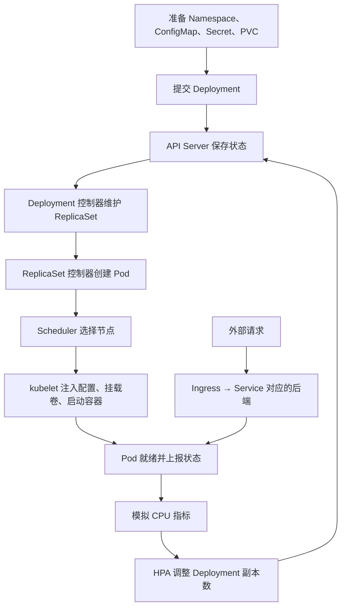

# learn-k8s

为了学习 Kubernetes 架构，用 Go 实现一个最小模拟，通过“部署一个 Java 服务”的例子，理解各组件如何协作。

## Java 服务部署例子

声明一个 Java Deployment，指定镜像、三个副本及资源需求。API Server 保存配置，Deployment 控制器维护 ReplicaSet，ReplicaSet 控制器补齐 Pod，Scheduler 选择节点，kubelet 模拟启动容器并上报就绪状态，最后通过 Service 和 Ingress 模拟访问。

同时演示 Namespace 分组、ConfigMap/Secret 配置注入、PVC 共享存储，以及 HPA 根据 CPU 指标调整副本数。容器退出由 kubelet 重启，Pod 删除后由 ReplicaSet 控制器补建。



需要 Go 1.22+，无第三方依赖：

```bash
cd ~/workspace/Traditional/learn-k8s
go run .
go test -v ./...
```

从 [`main.go`](main.go) 开始阅读，各组件按文件拆分并附中文注释。部署配置在 [`deployment.json`](deployment.json)。程序使用单进程和内存模拟，不会实际启动 Java 容器、创建磁盘或转发网络流量。

## Kubernetes 示例 YAML

[`examples/k8s/`](examples/k8s/) 提供同一个 Java 服务的真实 Kubernetes 配置，各文件附中文注释：

| 文件 | 内容 |
|---|---|
| [`namespace.yaml`](examples/k8s/namespace.yaml) | 创建 `learn` 命名空间 |
| [`configmap.yaml`](examples/k8s/configmap.yaml) | 普通应用配置 |
| [`secret.yaml`](examples/k8s/secret.yaml) | 示例数据库账号密码 |
| [`pvc.yaml`](examples/k8s/pvc.yaml) | 申请 10Gi RWX 共享存储 |
| [`deployment.yaml`](examples/k8s/deployment.yaml) | 三副本、配置引用、资源限制、探针和卷挂载 |
| [`service.yaml`](examples/k8s/service.yaml) | ClusterIP 内部入口 |
| [`ingress.yaml`](examples/k8s/ingress.yaml) | 域名和路径路由 |
| [`hpa.yaml`](examples/k8s/hpa.yaml) | 根据 CPU 指标在 3—10 个副本间伸缩 |

部署前替换镜像、数据库配置、存储类、IngressClass 和域名。集群需提供支持 RWX 的存储、Ingress Controller 和 HPA 所需的资源指标接口；Java 应用需监听 8080 并提供 `/health`、`/ready`。示例不包含数据库部署或 TLS 配置，Secret 中仅使用演示值。

在项目根目录向真实集群提交：

```bash
kubectl apply -f examples/k8s/namespace.yaml
kubectl apply -f examples/k8s/
kubectl get pods,svc,ingress,pvc,hpa -n learn
```

Go 模拟程序读取 JSON，不解析这些 YAML；YAML 用于对照学习及在准备好的真实集群中部署。

## MySQL Operator 最小例子

`examples/mysql-operator/` 用内存模拟一主二副本：CR 声明 → Operator 初始化 → MySQL 选新主 → Router 切换连接 → kubelet 重启旧主 → Operator 协调同步、重新加入。

```bash
go run ./examples/mysql-operator
```

CRD 只负责注册资源格式，例子用 Go 结构体表示 CR，不实现真实 CRD 注册或 MySQL 协议。选举和数据同步均为职责演示，不是生产算法；Service 地址保持不变，也不修改 Ingress。
